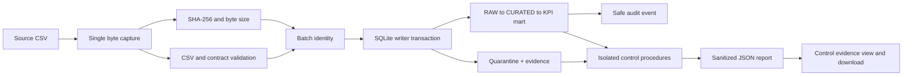
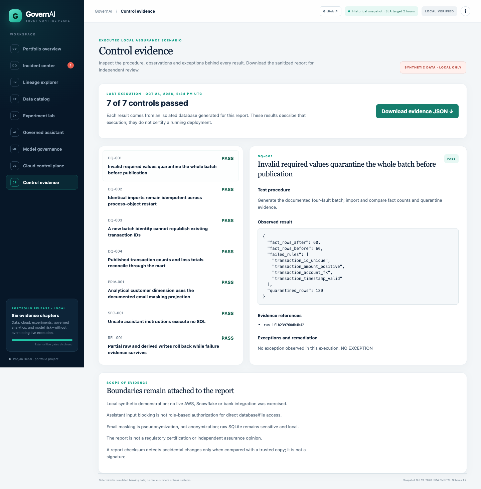

# Source integrity and executable control evidence

## Problem and design

The ingestion path previously read CSV rows, reopened the path for SHA-256, and
then separately measured the path. If an upstream producer replaced the file
between those operations, a successful run could attribute published records to
the wrong source bytes. The fix captures bytes once, then derives the CSV rows,
headers, checksum and byte count from that capture. This preserves file-atomic
validation, database replay checks, savepoint rollback and deterministic batch
identity. Inputs remain local synthetic CSV; this does not authenticate an
untrusted producer or prevent a filesystem writer from changing future files.



A second gap was evidence portability. Seven executable procedures now produce
objectives, procedures, timestamps, results, aggregate observations, run/implementation
references, exceptions and remediation status. The report runs only against a
new temporary database and removes it afterward. It never opens `.local/governai.db`
or cloud resources. Each run generates new run IDs and execution timestamps;
source bytes and control outcomes are reproducible, while report bytes vary with
those provenance fields. JSON and its SHA-256 sidecar are saved together.

## Reproduce

Python 3.12+ and Node 22+:

```sh
npm ci
npm run controls
npm run test:python
npm run test:web
npm run lint
npm run build
npm run dev
```

Open the printed loopback URL. Choose **Control evidence**, select a procedure,
inspect the observations, and download the JSON. The view displays the checked-in
execution, refreshed by `npm run controls`; it is not a live monitoring service.

For a fresh report at another location:

```sh
PYTHONPATH=backend python3 -m governai.cli controls --output .local/control-evidence.json
```

The command exits nonzero if any procedure fails. Procedures cover invalid batch
quarantine, replay after reopening the database, cross-batch duplicate rejection,
raw/curated/mart reconciliation, email projection masking, assistant input blocking
with zero SQL statements executed, and fault-injected rollback after derived writes.

Browser verification (leave the local server running in a second terminal):

```sh
npx playwright install chromium
npm run test:browser
```

The browser script supports `BASE_URL`, `PLAYWRIGHT_CHANNEL` (the verified local
run used installed Chrome), and `BROWSER_EVIDENCE_DIR`. Default evidence output is
`.local/browser-controls`. It checks all seven procedure selections, JSON download
against the source report, desktop/mobile layout, keyboard focus and page errors.



## Verified results on October 24, 2026

- Before this work: 50 Python tests and 12 Node tests passed.
- After this work: 57 Python tests and 13 Node tests passed, no skipped tests.
- Lint and production TypeScript/Vite build passed.
- Seven executable control procedures passed on the isolated synthetic scenario.
- Browser workflow passed at 1440×1100 and 390×844.
- A subprocess was killed after raw writes but before commit. Reopening SQLite
  showed zero partial transaction rows and no uncommitted run; integrity check
  passed and reimport succeeded. This is an actual process-interruption test,
  not just a mocked exception.
- Production dependency audit initially found Vite advisories. Vite was pinned
  from 8.2.1 to 8.3.5; the final production audit reported zero vulnerabilities.
  This is registry-audit evidence at execution time, not proof of no vulnerabilities.
- Development/preview servers now default to loopback. No public deployment ran.

## Security boundary and remaining work

The SQL role and masking definitions are cloud implementation artifacts, not
locally enforced raw-file RBAC. The assistant blocks unsafe questions through a
small approved-intent boundary. Anyone with local database access can read raw
synthetic rows. Email masking and deterministic customer tokens are not
anonymization. Control JSON contains no source paths, raw customer/account IDs,
names, emails or phones. Hashes detect accidental changes against a trusted copy;
there is no external signature or immutable evidence store. A failure during
report setup raises rather than generating a misleading PASS report.

Cloud adapters, dbt and Terraform were not live-executed; no credentials or billable
resources were used. Persistent historical control runs, fresh-label monitoring,
local authenticated ingestion, fully incremental mart updates and cloud replay
semantics remain out of scope. Report scenarios exercise a small synthetic
sample and cannot certify correctness of all possible input combinations.

## Two engineering stories

### 1. Closing a provenance race without replacing ingestion

**Context:** Existing ingestion was already atomic in SQLite and protected against
concurrent transaction replays. Database correctness alone did not bind the
manifest to the parsed file version. **Alternatives:** A file lock depends on the
upstream writer honoring the lock; rereading and comparing still adds another
race. **Decision:** Capture the input once, preserving the existing in-memory CSV
architecture. **Implementation:** `SourceSnapshot` binds rows/columns/hash/size,
and ingestion records the capture's identity. **Validation:** Replace or remove
the file immediately after capture, then verify original rows and manifest values
still agree; reject undecodable bytes before database writes. **Result:** The
manifest describes exactly the captured bytes used for publication. **Limit:**
Memory use includes both source bytes during parsing and parsed rows; very large
sources would need a bounded stream or immutable staging artifact. **Lesson:**
Provenance is a data integrity invariant, not just a logging concern.

### 2. Turning tests into inspectable controls without inventing certification

**Context:** Tests proved behaviors but a reviewer needed readable, sanitized,
portable evidence. **Alternatives:** Static green badges are easy to stale;
querying the developer's live database risks privacy and nondeterminism.
**Decision:** Execute an isolated synthetic scenario and emit structured procedure
results. **Implementation:** Seven controls record objectives, observations,
references and exceptions; React renders the resulting JSON and exports the same
state. **Validation:** Inject broken masking and require a FAIL report; verify
sidecar digest and privacy boundaries; click each procedure and compare the
browser download with the original object. **Result:** A reviewer can reproduce
both a passing execution and a meaningful failure. **Limits:** The reporter uses
some shared helpers and is not independent external assurance; separate tests
and explicit unmasked-value checks reduce self-confirming assertions. **Lesson:**
A control report must retain scope and exceptions alongside green results.
